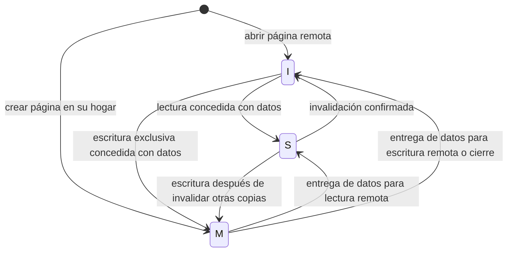

# Arquitectura de la entrega final

## De una terminal a una reserva

Un puesto es un proceso Linux con IPv4, puerto, ID DSM y capacidad configurada. Un equipo puede alojar varios puestos. `dsm_unir` inicia `dsm_consola`. Cada instancia reclama un endpoint local con un socket UNIX abstracto por IPv4 y puerto y una comprobación del puerto TCP. El argumento opcional admite entre 1 y 8 procesos y deja el último interactivo. Cada instancia de una aplicación reclama además su propio puesto. No se lanzan Pthreads ni procesos en otro equipo por control remoto.

Todos usan la misma configuración inmutable. Para cada pareja, el ID menor intenta la conexión al mayor, que acepta. El alta intercambia identificadores y configuración, y el enlace se mantiene mediante heartbeat con correlación y plazo. El reintento es periódico. El hogar coordina sus páginas, y el creador coordina su reserva. Las aplicaciones eligen un líder únicamente para una ejecución.

`dsm_context_t` agrupa configuración, directorio, coherencia, paginador, proceso lógico, trabajadores y vinculaciones. El ID de reserva combina el nodo creador en 16 bits altos con un consecutivo de 16 bits bajos. Un reinicio puede reutilizar un ID numérico. El token de una sesión distingue operaciones de capacidad y los anuncios de nuevas ejecuciones. El GPN es de 64 bits y se calcula con bases prefijas según el orden y las capacidades nominales del INI. Una caída conserva el espacio lógico del puesto.

El manifiesto asocia ordinales de página a tramos de GPN de varios hogares. El creador prepara primero capacidad local, prioriza hogares conectados y permite una espera acotada para nuevos aportantes. A continuación confirma el manifiesto, registra la vista y lo publica. Un fallo durante la preparación cancela aportes. Un cliente consulta al creador para abrir y posteriormente habla directamente con el hogar de cada página. Al cerrar se revocan las copias y se devuelven los aportes. Los mensajes de capacidad tienen un token para distinguir reintentos y sesiones. La cota del manifiesto es de 256 tramos, hasta 16 solicitados por hogar. La fragmentación puede impedir una reserva aunque la suma de bytes libres parezca suficiente.

## Vistas, paginación y MSI

`memfd_create` y `ftruncate` proporcionan el respaldo local. `Ar` y `Cr` son dos mapeos `MAP_SHARED` del mismo objeto. La aplicación usa una ventana contigua y el directorio instala datos por `Cr`. Los permisos de `Ar` cambian por página. El manejador de SIGSEGV con SA_SIGINFO usa `si_addr`, la ventana del trabajador y una solicitud preasignada. Publica con atómicos lock-free, despierta al paginador con `sem_post` y espera con `sigsuspend`. El hilo paginador resuelve el permiso y despierta al trabajador con SIGUSR1. Un fallo ajeno a un acceso permitido por el DSM sigue la terminación por señal. La ruta de copia controlada comparte el resolutor MSI y comunica errores al llamador.

El diagrama representa **una copia local** de una página. En el hogar se conserva además el directorio autoritativo con el poseedor, la máscara de copias, versión y estado de recuperación.

La copia inválida tiene protección `PROT_NONE`; una compartida admite lectura y la modificada admite lectura y escritura. Al conceder M el hogar deja un solo bit en la máscara. Una promoción de S puede omitir la carga si el solicitante posee los datos vigentes. El antiguo M entrega la imagen antes de que el hogar permita a otro nodo continuar. Una transferencia ambigua puede dejar la página marcada como perdida y protegida. En ese estado, retirar una copia remota exige una invalidación confirmada. Si el ACK falta, el hogar conserva la referencia y el cliente puede reintentar. La confirmación permite retirar esa referencia y, finalmente, liberar la reserva. La página perdida sigue inaccesible hasta entonces. Los permisos de la vista de un donante desvinculado pueden ser cero aunque su `Cr` conserve datos.

## Mensajes TCP

Cabecera big-endian de 32 bytes con magic, versión, tipo, banderas, longitud, origen, destino, ID de mensaje, correlación y estado. Longitud total máxima de 1 048 576 bytes. Los valores se pueden contrastar en `include/protocol.h` y los codecs en `src/protocol.c`.

| Hexadecimal | Solicitud / respuesta | Uso |
|---|---|---|
| 01, 02 | NODE_HELLO, NODE_WELCOME | Alta de la pareja. La revisión distingue sesiones de publicación. |
| 03, 04 | NODE_BYE, NODE_DOWN_HINT | Salida anunciada; el receptor también conoce la pista de baja. El cierre normal emite BYE. |
| 05, 06 | HEARTBEAT, HEARTBEAT_ACK | Comprueban vida con ID, marca y tiempo correlacionados. |
| 10, 11 | PAGE_REQUEST, PAGE_DATA | Lectura, exclusividad, datos o concesión sin carga. |
| 12, 13 | PAGE_DOWNGRADE, PAGE_DOWNGRADE_ACK | Recuperación desde M; si procede hay además PAGE_DATA con la imagen. |
| 14, 15 | INVALIDATE, INVALIDATE_ACK | Revocación de una copia antes de conceder exclusividad. |
| 30, 31 | STATS_REQUEST, STATS_REPLY | Ficha, contadores, descriptores y consultas por rangos de GPN. Un error de formato o capacidad se correlaciona con la solicitud. |
| 32, 33 | REGION_LOOKUP, REGION_INFO | Abrir una reserva y obtener su manifiesto y tamaño lógico. |
| 34, 35 | REGION_CLOSE, REGION_CLOSE_ACK | Comunicar al creador el cierre de una vinculación. |
| 40, 41 | CAP_PREPARE, CAP_PREPARE_ACK | Obtener tramos disponibles en el hogar. |
| 42, 43 | CAP_COMMIT, CAP_COMMIT_ACK | Confirmar los tramos preparados. |
| 44, 45 | CAP_CANCEL, CAP_CANCEL_ACK | Deshacer preparaciones. |
| 46, 47 | CAP_RELEASE, CAP_RELEASE_ACK | Devolver capacidad confirmada. |
| 48, 49 | REGION_COPY_CLOSE, REGION_COPY_CLOSE_ACK | Retirar las copias de un participante en cada hogar. |
| 60 | ANUNCIO | Clave, autor, sesión, generación y hasta 128 bytes. Difusión directa y reproducción del autor al establecer enlace. |
| 7F | PROTO_ERROR | Comunica tipo desconocido y el ID causante. Despierta la RPC de coherencia correlacionada. |

Los manifiestos públicos llevan la marca opcional de cuatro bytes `PUB1` después de los tramos. Los de servicio históricos conservan su longitud anterior. El mismo sello acompaña la reserva durante preparación, confirmación y apertura, de modo que un hogar remoto puede identificar su procedencia. En STATS, los selectores históricos conservan la solicitud de 40 bytes. Inventario y copias por rango usan una solicitud de 48 bytes con versión, GPN inicial y límite. La respuesta paginada lleva la bandera de rango, un cursor y el indicador de continuación. Los tipos de mensaje y la cota de la trama no cambian. Desplegar la misma revisión en todas las máquinas.

## API y concurrencia

| Funciones públicas | Contrato operativo |
|---|---|
| `dsm_pool_reclamar`, `dsm_pool_liberar`, `dsm_sondear`, `dsm_iniciar`, `dsm_cerrar` | Reclaman/liberan un puesto e inician/cierran un contexto por proceso. Un cierre exitoso consume el contexto. |
| `dsm_proc_abrir`, `dsm_hilo_registrar`, `dsm_hilo_desregistrar` | Identifican al proceso lógico y los trabajadores que usan punteros prestados. |
| `dsm_reservar`, `dsm_abrir_reserva`, `dsm_consultar_reserva`, `dsm_ubicacion_pagina`, `dsm_traducir` | Crean o vinculan la reserva. Permiten consultar el estado real de la vinculación local sin RPC, el hogar/GPN por ordinal y la dirección por desplazamiento. Durante la retirada se conserva la identidad y se suspende el préstamo del puntero. |
| `dsm_leer`, `dsm_escribir` | Validan tamaño lógico y mantienen vivas las ventanas durante la copia. Cero bytes admite NULL dentro del rango. Una lectura a memoria ordinaria publica el resultado completo al final. En una escritura se guarda el valor anterior de cada trozo bajo el mutex del directorio. Ante error solo se restaura si siguen coincidiendo identidad, exclusividad M, versión y bytes escritos, sin pedir un permiso nuevo por RPC. Una escritura o una lectura con destino DSM pueden dejar trozos completados ante error. Los buffers ordinarios deben ser válidos para la operación. |
| `dsm_desvincular_reserva`, `dsm_liberar` | El cliente entrega las copias y el creador recupera sus tramos. Una vinculación vigente puede devolver OCUPADA. |
| `dsm_aviso_publicar`, `dsm_aviso_consultar`, `dsm_aviso_consultar_autor`, `dsm_aviso_participantes`, `dsm_aviso_retirar`, `dsm_aviso_sesion` | Publicaciones asíncronas por autor y sesión, claves de 1–31 bytes, cargas de 0–128 y tabla de 128 entradas. La publicación local exitosa acredita aceptación local. |
| `dsm_consultar_nodo`, `dsm_consultar_nodos`, `dsm_consultar_paginas`, `dsm_consultar_rango`, `dsm_imprimir` | Una ficha por puesto configurado; para ausentes se conserva la memoria nominal con cero disponible. Una RPC vencida se informa como SOSPECHA, y un enlace desconectado como FUERA. Las filas globales proceden del hogar. Un hogar concreto inaccesible devuelve error; una consulta general informa PARCIAL. En las consultas históricas de nodos y páginas, un buffer insuficiente recibe el prefijo y NOMEM con el total observado. La consulta por rango recibe espacio para el límite solicitado y devuelve cantidad, cursor y continuación. |

El directorio protege descriptores y transiciones, y separa el servicio de pedidos de los controles de coherencia. Cada RPC identifica par, tipo esperado, ID y plazo monotónico. El mutex de coherencia se suelta antes del envío y durante la espera en la condición. La instalación de PAGE_DATA se ordena respecto de la siguiente invalidación recibida por ese enlace. Los avisos tienen una cola de entrega independiente. Las consultas mantienen una referencia de vida del contexto mientras consultan y sueltan el mutex del API. Se imprime después de recibir los datos. Las rutas históricas de creación y liberación aún serializan operaciones bajo el mutex del API; los lectores TCP y callbacks del paginador son independientes de él. Las pruebas concurrentes son evidencia del recorrido ejecutado, no una demostración de progreso para todos los intercalados.

Los ocho contadores por sesión representan resoluciones de faltas de lectura/escritura, invalidaciones enviadas/recibidas, páginas de datos transferidas en ambos sentidos y bytes de carga de esas páginas. Una caché con permiso vigente puede atender numerosos accesos sin incrementar faltas. Las transferencias incluyen la devolución de un antiguo M, y excluyen cabeceras, concesiones vacías y el camino local. En una ficha fuera de línea, la capacidad configurada sigue siendo nominal y el cero de ocupación no aporta una medición del hogar caído. En línea, `aportados` cuenta páginas ocupadas, `libres` cuenta páginas y `memoria` es capacidad nominal en bytes. En una página, `orden` es el ordinal dentro de la reserva (no un reloj global de asignaciones). `permiso` describe la vista local del emisor. `proc` es el proceso de la última solicitud anotada y puede valer cero antes del primer pedido. Las observaciones de hogares distintos corresponden a instantes distintos. Los fallos se contabilizan al intentar una resolución sin permisos suficientes, incluso si la RPC posterior falla. Las invalidaciones recibidas incluyen las que encuentran la copia ya inválida. Los envíos y recepciones tienen contadores distintos.

### Propiedad e inventario

El identificador del propietario público es `(nodo_creador << 16) | 1`. Esta derivación depende de dos invariantes del API actual. Cada contexto abre un solo proceso lógico y comprueba esa identidad al reservar. El manifiesto marcado como público permite aplicar la fórmula también en los hogares donantes. El directorio histórico puede tener IDs de reserva con el mismo formato y deja el propietario lógico en cero. El último solicitante anotado por PAGE_REQUEST, incluso cuando la solicitud es rechazada, puede cambiar sin alterar creador, propietario u ordinal.

Para inventariar un hogar, se lee bajo el mutex del directorio el mapa de ocupación, se cruzan los tramos preparados y se añaden los descriptores confirmados. Una incoherencia entre esas estructuras produce error. La consulta de copias enumera las vistas vinculadas del observador con sus permisos, incluso cuando se invalidaron. La capacidad de un hogar se cuenta una sola vez. Las filas se ordenan por GPN, la tabla por consulta tiene hasta 1024 filas y el cursor permite continuar. La consola conserva la ocupación desconocida de los ausentes y calcula el porcentaje sobre la capacidad activa que se logró consultar.

## Aplicaciones y procedencia

El anuncio inicial y `dsm_sondear` adelantan reintentos hacia endpoints configurados con un presupuesto de tiempo común. La ventana de estabilidad permite reunir candidatos después del sondeo. El formato privado DGR3 representa los IDs 0–59 en un byte dentro del anuncio de 128 bytes. El API y la lista ordenada usada para el digest conservan IDs de 16 bits. El miembro con menor ID de una propuesta consensuada anuncia una lista ordenada y un token. Cada integrante verifica la lista y las sesiones y confirma antes de que el creador publique recursos. Los IDs de reserva se acompañan de tamaños y parámetros. La página de control contiene fase, token, generación y marcas por ordinal. Un proceso solo escribe su propia marca y el líder valida la generación antes de avanzar. En una red particionada no se puede garantizar un único grupo entre componentes sin contacto.

Matrices conserva el reparto estático y el producto escalar de Perlet, y distribuye páginas disjuntas de C. Merge Sort adapta la combinación de Lavello a rangos de `int32_t` y distribuye bloques y niveles de fusión. En ambos los Pthreads se registran localmente. El líder de una ejecución sigue siendo también un trabajador. Los donantes independientes prestan memoria aunque no ejecuten el algoritmo. Los originales MIT, sus revisiones, las diferencias algorítmicas y las verificaciones están documentados en las respectivas carpetas. [Matrices](../apps/matrices/UPSTREAM.md) · [Merge Sort](../apps/mergesort/UPSTREAM.md)

## Administración desde un nodo activo

La consola mantiene un contexto y un proceso lógico hasta el cierre. Puede aportar y abrir varias reservas. El creador y los clientes usan el mismo directorio y paginador que las aplicaciones. Las tareas de patrón ejecutan Pthreads sobre rangos disjuntos y devuelven sus resultados a la consola. El hilo que procesa comandos permanece sin registro permanente. La liberación se reintenta si otro cliente sigue vinculado. Matrices y Merge Sort continúan siendo procesos y puestos independientes. El modelo admite un proceso lógico por contexto y carece de clientes IPC con PID independientes.

Con 60 puestos, la red solicita 59 buffers de recepción de 1 MiB y crea 59 trabajadores de enlace por proceso, incluidos los pares ausentes. El espacio de direcciones también incluye pilas, bibliotecas y vistas. Estos recursos del proceso Linux son independientes de los 8 MiB de capacidad lógica ofrecida al DSM. Los resultados medidos para uno, dos y tres procesos figuran en [la validación de 14D](validacion-14d.md).

## Restricciones operativas

Se admiten hasta 60 puestos, IDs densos 0–59, máscaras DSM de 64 bits y hasta 64 trabajadores configurados por puesto. Las páginas DSM deben ser potencia de dos, al menos una página del sistema y hasta 65536 bytes. Cada puesto admite hasta 64 MiB nominales, alineados a página. El máximo de 100 números de puerto en el rango asignado no amplía las tablas de participantes. El nombre UNIX abstracto del puesto se comparte entre cuentas del mismo espacio de red; Linux lo libera al cerrar el último descriptor y lo aísla entre espacios de red. Un programa externo que no participe en la reclamación podría tomar el puerto TCP entre la sonda y la escucha real. El `bind` definitivo rechaza la colisión.

Es una malla de laboratorio de confianza. Todos deben compilar la misma revisión, usar ABI compatible para los avisos de aplicación y el mismo INI. No hay persistencia, redundancia de páginas modificadas ni migración automática de un hogar caído. La reincorporación habilita trabajo nuevo. Para cambiar el reparto entre equipos manteniendo GPN ya publicados haría falta separar la identidad lógica estable de la dirección que reclama el puerto y resolver colisiones entre reclamantes. Es una propuesta de membresía para revisar aparte. El reparto no uniforme configurado antes del arranque ya está disponible. Para preservar también las bases existentes, se pueden mantener los IDs y capacidades en filas explícitas y cambiar solo el endpoint de puestos seleccionados en una sesión nueva.

[Guía de instalación y demostración](guia-laboratorio.md)
